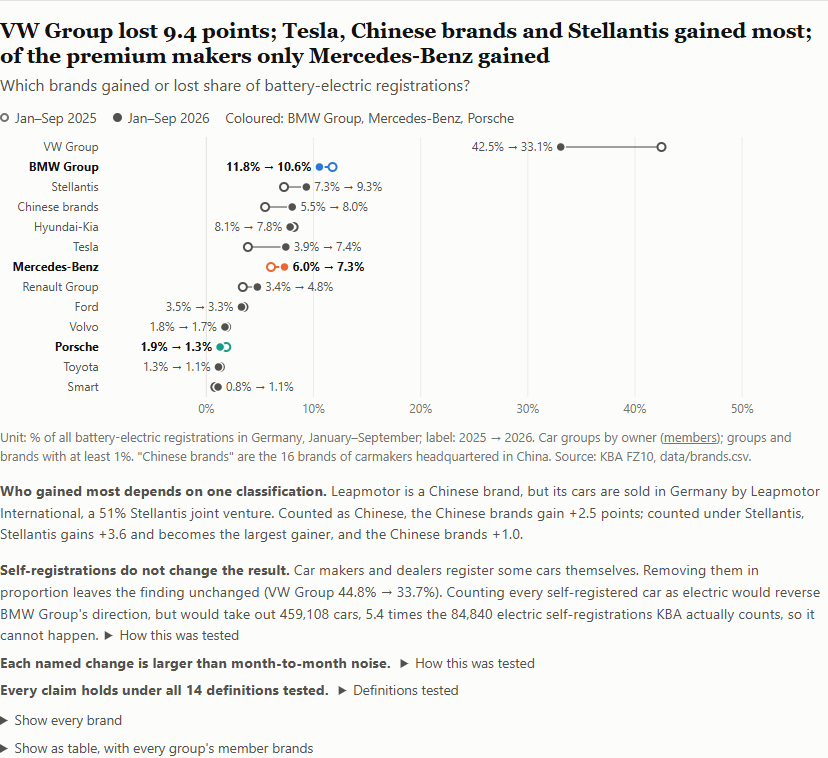

# German EV shift: who captured Germany's 2026 electric-car boom

By Joshua Musick, first-year Bachelor in Management, ESCP Business School · October 2026 · public data only

**Answer. Germany's electric-car market grew 58% in January–September 2026, but VW Group's share fell from 42.5% to 33.1% as Tesla, Chinese brands and Stellantis took share. Of the German premium makers, Mercedes-Benz gained (6.0% to 7.3%); BMW Group (11.8% to 10.6%) and Porsche (1.9% to 1.3%) lost.**

- Dashboard: https://jtmf-beep.github.io/german-ev-shift-public/ (the same page opens from disk: `docs/index.html`)
- One-page memo: [memo.md](memo.md) / [memo.pdf](memo.pdf); German translation: [memo.de.md](memo.de.md) / [memo.de.pdf](memo.de.pdf)
- Data: [brands](data/brands.csv), [model series](data/models.csv), [keepers](data/keepers.csv), [company figures](data/ir_figures.csv), [context figures](data/context_figures.tsv); every column described in the [data dictionary](docs/data-dictionary.md)
- Decisions and why: [docs/decisions.md](docs/decisions.md) · Rerun and monthly update: [docs/maintaining.md](docs/maintaining.md)

**Self-registrations do not change the result.** Removing cars that makers and dealers registered themselves in proportion leaves VW Group at 44.8% → 33.7%; counting every self-registered car as electric would reverse BMW Group, but would take out 459,108 cars, 5.4 times the 84,840 electric self-registrations KBA counts. Every named change is larger than month-to-month noise.

**Who gained most depends on one classification.** "Chinese brands" are the 16 brands of carmakers headquartered in China (`scripts/groups.js`). Leapmotor is one of them, but Stellantis sells its cars in Germany through a 51% joint venture; counted under Stellantis, Stellantis gains 3.6 points and Chinese brands 1.0.

**Who each output is for.** Memo: strategy readers. Group and model tables: carmaker market-intelligence teams. Watch-list: bank and investor-relations readers.

## What this means for each company

- **VW Group** added 37,462 electric cars (+23%) but lost 9.4 points, because the market grew 58%; it has cut its 2026 forecast to an operating return on sales of "up to 1 percent". By Volkswagen's own count, its share of Western Europe's electric market fell less, from 27.1% to 21.7% in January–June, against 46.4% to 36.3% in Germany counting Porsche. Expect the loss to narrow only if its registrations grow faster than the market.
- **BMW Group** grew 42% against the market's 58%, mostly in the X1 and X3 series (the X3 row includes the new iX3); with margin guidance cut to 1–3%, the iX3 has to lift both share and margin.
- **Mercedes-Benz** is the only premium maker that gained share, on two launches (CLA and the electric GLC) while its older electric models fell; expect the gain to hold while those launches are new.
- **Porsche** grew 9% and had the steepest margin fall. Its *automotive* return on sales was 8.0% in the first half of 2026 (5.2% a year earlier); its *group* targets are a different base (5.5–7.5% for 2026, 10–15% medium term).

These are readings of public data, not recommendations to the companies or to investors.

## Watch-list (educational)

| Date | Event | What to watch |
|---|---|---|
| 27 October 2026 | Porsche third-quarter statement | Automotive return on sales against 8.0% in the first half |
| 28 October 2026 | Mercedes-Benz third-quarter report | Electric sales and adjusted return on sales against the 3–5% guidance |
| 29 October 2026 | Volkswagen nine-month report | Margin against the forecast of up to 1% |
| 4 November 2026 | BMW third-quarter statement | Automotive margin against the 1–3% guidance |
| 6 November 2026 | KBA FZ10 for October 2026 | Whether VW Group's share is above 33.1% |

Dates from each company's financial calendar and the KBA publication calendar (SOURCES.md).

## Method

KBA registration tables for every brand and model series (FZ10, 69 monthly files), keeper groups (FZ8, FZ28), and the companies' reports, combined by plain Node scripts; every table is reconciled with KBA's own totals and every number in this README is recomputed by a script. Details, including the policy context: [docs/method.md](docs/method.md). Every check in one command: `node scripts/check-all.js` (add `--online` to request every link).

## How this was made

- **Tools.** Claude Code (Anthropic's AI coding assistant, model Claude Opus 5.5, October 2026); Node 24 runs the pipeline; Chromium renders the dashboard checks and the memo PDF.
- **How the output was checked.** Every number is recomputed by a script from the raw files or a quoted line of a source.
- **Authorship.** Directed by Joshua Musick. Built with Claude Code (Anthropic), which wrote the code, the checks and the first drafts of the text.

## Limitations

- **Registrations are not sales.** KBA publishes keeper groups by brand for all drives only, so self-registration rates are not split into electric and other cars.
- **Timing is not cause.** New models and the EU CO2 targets moved in the same months as the 2026 bonus.
- **Model series mix generations** (the BMW X3 row holds the new iX3 and older models).
- **Margins are worldwide and company-defined** (definitions in docs/method.md); none of the three publishes a margin for electric cars alone, and Porsche publishes no total of electric deliveries, so no cost per electric car is computed.
- What the scripts cannot catch: end of SOURCES.md. Sources with URLs and dates: [SOURCES.md](SOURCES.md). Registration data © Kraftfahrt-Bundesamt, dl-de/by-2-0 (https://www.govdata.de/dl-de/by-2-0). Not investment advice.

---

Public-data analyses of European companies by Joshua Musick (ESCP Business School): every number traces to its source.
