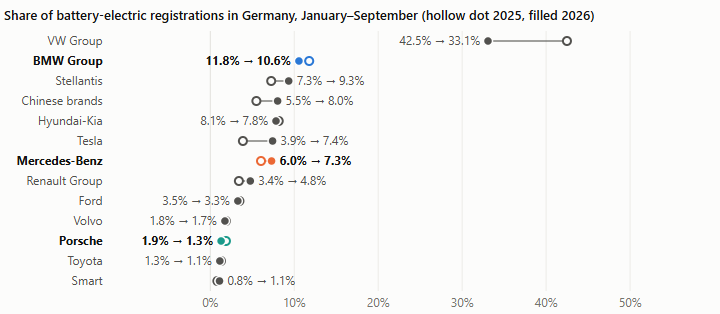

# Wer hat Deutschlands E-Auto-Boom 2026 für sich genutzt?

Joshua Musick, ESCP Business School · 9. Oktober 2026 · mit KI-Programmierassistent erstellt · übersetzt aus memo.md

Der deutsche Elektroautomarkt wuchs von Januar bis September 2026 um 58 %, doch der Anteil des VW-Konzerns fiel von 42,5 % auf 33,1 %, während Tesla, chinesische Marken und Stellantis Anteile gewannen. Von den deutschen Premiumherstellern legte nur Mercedes-Benz zu; BMW Group und Porsche verloren.

## Vier Ergebnisse

**1. Der VW-Konzern wuchs, aber weit langsamer als der Markt.** Er ließ 37.462 Elektroautos mehr zu als ein Jahr zuvor, ein Plus von 23 %, während der Markt um 58 % wuchs; bei Marktwachstum hätte er seinen Anteil gehalten. Das gilt auch ohne Hersteller- und Händlerzulassungen; jede genannte Veränderung übersteigt die Schwankung von Monat zu Monat.

**2. Mercedes-Benz gewann mit zwei neuen Modellen.** Sein Anteil stieg um 1,3 Punkte. CLA und elektrischer GLC brachten 24.001 zusätzliche Elektroautos, mehr als der gesamte Zuwachs der Marke, während ältere Elektromodelle zurückgingen. Die BMW Group verlor 1,2 Punkte, Porsche 0,6.

**3. Der Schub nach der Förderung war rein elektrisch.** Nach dem Start der Förderung am 19. Mai wuchsen die batterieelektrischen Zulassungen um 43 Prozentpunkte schneller als zuvor, gemessen an Diesel als Kontrolle; Plug-in-Hybride, ebenfalls förderfähig, bewegten sich kaum (+1,5). Der Zeitpunkt passt zur Förderung, beweist sie aber nicht.

**4. Wer am meisten gewann, hängt an einer Zuordnung.** Leapmotor ist eine chinesische Marke, aber Stellantis steuert ihren Vertrieb in Europa über ein Gemeinschaftsunternehmen. Als chinesisch gezählt, gewannen die chinesischen Marken 2,5 Punkte; Stellantis zugerechnet, gewann Stellantis 3,6 Punkte und wird zum größten Gewinner, die chinesischen Marken 1,0.

Begriffe: KBA-Neuzulassungen, Januar bis September; elektrisch = batterieelektrisch; Anteil = Teil an allen elektrischen Neuzulassungen in Deutschland; chinesische Marken = Hersteller mit Sitz in China (Liste im README).

## Was es die Premiumhersteller kostet

Porsche ordnet Belastungen des Jahres 2025 von 2,4 Mrd. € seinem Elektroprogramm zu, 6,6 % seines Konzernumsatzes; Mercedes-Benz buchte 2024 Wertminderungen von 380 Mio. € auf Elektrofahrzeuge. Das sind die letzten gesondert ausgewiesenen Jahre; BMW weist solche Belastungen nicht aus.

## Was das Ergebnis ändern würde

- **Der VW-Konzern holt Anteile zurück**, wenn sein Anteil von Oktober bis Dezember 2026 über seinem Anteil von Oktober bis Dezember 2025 von 39,4 % liegt (KBA, Januar 2027).
- **Der Zuwachs der Herausforderer kehrt sich um**, wenn der Anteil der chinesischen Marken in diesem Quartal unter ihre 6,3 % des Vorjahres fällt.

## Quellen

Quellen mit Datum und Grenzen der Analyse: SOURCES.md und README.md. Keine Anlageberatung.
